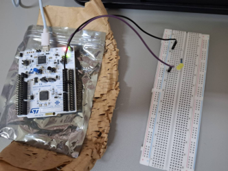
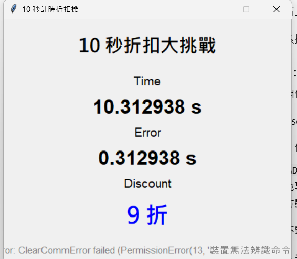

# STM32 Smart Discount Timer
## 10 秒計時折扣機

### 一、專題介紹

本專題使用 STM32 NUCLEO-G474RE 開發板，製作「10 秒折扣大挑戰」。

使用者第一次按下 B1 按鈕開始計時，第二次按下停止計時。系統會計算實際時間與 10 秒的誤差，依據誤差判斷折扣，並透過 UART 將結果傳送至電腦，由 Python tkinter GUI 顯示。

每次挑戰完成後，外接黃色 LED 會透過 PWM 產生三次呼吸燈效果，接著可以進行下一輪挑戰。

### 二、使用設備與開發工具

**硬體設備**
- STM32 NUCLEO-G474RE
- 黃色 LED
- 限流電阻
- 麵包板
- 杜邦線
- USB 傳輸線

**軟體工具**
- STM32CubeMX
- STM32CubeIDE
- STM32 HAL Library（C 語言）
- Python 3
- tkinter
- pyserial
- Visual Studio Code

### 三、硬體腳位設定

| 腳位 | 功能 | 說明 |
|---|---|---|
| PC13 | GPIO EXTI | B1 按鈕外部中斷 |
| TIM2 | Internal Clock | 硬體計時 |
| PA6 | TIM3 CH1 PWM | 黃色 LED 呼吸燈 |
| PA2 | LPUART1 TX | 傳送資料 |
| PA3 | LPUART1 RX | 串列通訊接收 |

TIM2 使用 1 MHz 計數頻率，每次計數代表 1 微秒。

TIM3 PWM 頻率為 1 kHz。

UART 通訊速率為 115200 baud，透過 ST-LINK Virtual COM Port 連接電腦。

### 四、折扣判斷規則

目標時間為 10 秒。

誤差計算方式：

Error = |實際時間 − 10 秒|

| 時間誤差 | 折扣 |
|---|---|
| ≤ 0.05 秒 | 5 折 |
| ≤ 0.20 秒 | 7 折 |
| ≤ 1.00 秒 | 9 折 |
| ＞ 1.00 秒 | 10 折 |

### 五、系統運作流程

1. 系統初始化，等待使用者按下 B1。
2. 第一次按下 B1，TIM2 開始計時。
3. 第二次按下 B1，TIM2 停止計時。
4. 讀取經過時間並計算與 10 秒的誤差。
5. 根據誤差判斷折扣。
6. 透過 LPUART1 傳送結果至電腦。
7. Python GUI 顯示 Time、Error、Discount。
8. 黃色 LED 呼吸三次。
9. 系統回到等待狀態，可以進行下一輪挑戰。

### 六、程式設計重點

**GPIO EXTI 外部中斷**

使用 PC13 的 B1 按鈕觸發中斷，透過 `HAL_GPIO_EXTI_Callback()` 判斷開始或停止計時。

**TIM2 硬體計時**

使用 TIM2 硬體計數器計算經過時間，不使用週期性 Timer 中斷，也不使用 `HAL_Delay(10000)` 等待挑戰結束。

**按鈕去彈跳**

使用 `HAL_GetTick()` 判斷兩次按鈕觸發的間隔，忽略 200 毫秒內的重複觸發。

**TIM3 PWM 呼吸燈**

利用 TIM3 Channel 1 的 PWM 改變占空比，使黃色 LED 逐漸變亮、逐漸變暗，總共重複三次。

**UART 通訊**

STM32 使用 LPUART1，透過 ST-LINK Virtual COM Port 以 115200 baud 將結果傳送至電腦。

資料格式範例：

`TIME=10.123456,ERROR=0.123456,DISCOUNT=7`

**系統狀態控制**

使用 `timer_running`、`result_ready` 和 `system_busy` 等狀態旗標，管理開始計時、停止計時與結果處理流程。

### 七、Python GUI

使用 Python tkinter 製作電腦圖形介面，搭配 pyserial 接收 STM32 傳送的 UART 資料。

介面包含：

- Time：實際計時秒數
- Error：與 10 秒的誤差
- Discount：獲得的折扣
- Connection Status：COM Port 連線狀態

程式預設使用 COM5、115200 baud。若其他電腦的 COM Port 不同，需要修改 `gui.py` 的 `PORT` 設定。

### 八、操作方式

1. 使用 STM32CubeIDE 開啟並編譯 STM32 專案。
2. 將程式燒錄到 NUCLEO-G474RE。
3. 確認外接 LED 與限流電阻接線正確。
4. 使用 Python 執行 `gui.py`。
5. 第一次按下 B1，開始計時。
6. 第二次按下 B1，停止計時。
7. 查看 Python GUI 顯示的計時結果與折扣。
8. 等待 LED 呼吸三次後，再開始下一輪挑戰。

執行 GUI：

```bash
python -m pip install pyserial
python gui.py
```

### 九、實作成果

本專題已完成 STM32 按鈕計時、折扣計算、UART 資料傳送、Python GUI 顯示，以及 PWM LED 呼吸燈功能，並完成實際開發板測試。

#### 1. STM32 硬體實作成果

使用 NUCLEO-G474RE 開發板，搭配黃色 LED、電阻與麵包板。透過 B1 按鈕控制計時，並使用 TIM3 PWM 控制 LED 呼吸三次。



#### 2. UART 通訊與 Python GUI 成果

透過 LPUART1 和 ST-LINK Virtual COM Port，以 115200 baud 將計時結果傳送至電腦，再由 Python tkinter GUI 顯示 Time、Error 和 Discount。


### 十、AI 輔助說明

本專題使用 ChatGPT 輔助 STM32CubeMX 硬體設定、HAL 程式撰寫、除錯及 Python GUI 開發。

實際操作包括自行建立專案、設定周邊功能、修改程式碼、編譯、燒錄、接線與功能測試。
